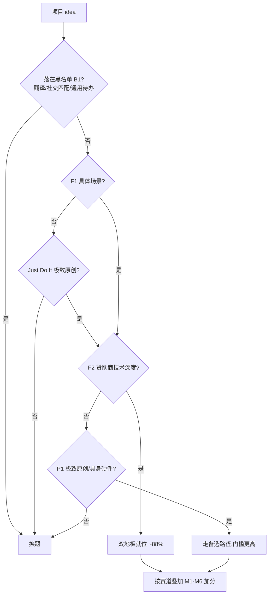

# AdventureX 2025 项目特性校验与选题指南

> 数据来源：[AdventureX Gallery](https://gallery.adventure-x.org/?event=advx-2025) | [赛道页面](https://gallery.adventure-x.org/tracks?event=advx-2025)
> 
> 校验日期：2026-07-20
> 
> 校验样本：222 个参赛项目中可结构化解析的 **218 个**（5 主题赛道全覆盖），获奖 112 个、未获奖 106 个
> 
> 配套文档：`AdventureX_2025_Analysis_Report.md`（评审逻辑与获奖规律深度分析）

---

## 一、为什么需要这份校验

此前在《选题与选赛道关键要求》中提出了 8 条"项目特性"。但特性是否真的有效，必须用真实获奖/未获奖项目反向验证，否则容易把"看起来合理但实际不成立"的建议写进指南。

本文做了三件事：

1. **校验**：把 8 条特性逐条放到 218 个项目上跑，看哪些成立、哪些被推翻。
2. **更正**：对被推翻或夸大的特性，给出适用边界与重新表述。
3. **补充**：补上校验过程中新发现的关键特性（尤其是 1 条"地板特性"和 1 条"黑名单"）。

> 说明：本文是分析指南类文档（同 `Analysis_Report`），无对应 Excel；其结论可直接用于 2026 选题自检。

---

## 二、校验方法

用脚本解析 Gallery 全文，对每个项目提取：主题赛道、奖项数、一句话描述、技术栈、参与赞助商。然后：

- **关键词获奖率**：统计含某关键词的项目获奖率，与整体 53.6% 对比。
- **组合获奖率**：把"场景词 × 技术栈是否含赞助商/前沿技术"做交叉，看组合获奖率。
- **极端案例比对**：抽取多奖项目（≥3 奖）、看似完美却 0 奖的项目、例外项目（无赞助商技术却多奖），逐个人工核对描述与技术栈。

样本分布：AllWeDo 27 / Gamify 24 / JustDoIt 56 / OneWorld 37 / ReMake 74。

---

## 三、8 条特性的逐条校验结果

| #   | 原特性             | 校验结论          | 关键数据                                                             | 是否保留               |
| --- | --------------- | ------------- | ---------------------------------------------------------------- | ------------------ |
| 1   | 有具体场景，不做"XX 平台" | 部分成立，需重定义     | "平台"31%、"社交"27%（低）；但 10/32 平台项目仍获奖；Just Do It 多奖项目无场景            | 保留并**收窄适用范围**      |
| 2   | 可演示 / 实物感       | 软件部分被推翻       | 软件 Demo 链接有无：51% vs 55%（基本无差异）；硬件实物 61–65%                       | 保留并**重定义**         |
| 3   | 重构对象（ReMake）    | 成立但赛道专属       | 仅适用 ReMake/工具类                                                   | 保留并**标注赛道专属**      |
| 4   | 主动 Agent 而非被动应答 | 部分成立          | "Agent"69%、"自动化"100%、"协作"80%；但"助手"62%（并非致命）                      | 保留并**标注赛道专属**      |
| 5   | 单一叙事锚点（跨界要有机）   | 成立，是加分而非必要    | 叙事型 62%；但 InstaGo/MyWear 等工具型获奖无叙事；InSight/MemorySpace 5 域拼盘 0 奖 | 保留为**加分项**         |
| 6   | 温度落在真实痛点        | 成立但赛道专属、单独不救命 | 仅 OneWorld/AllWeDo 加分；回声Petecho/声启有温度却 0 奖                       | 保留并**标注赛道专属 + 警告** |
| 7   | 全链路完成度          | 强成立           | 所有 ≥3 奖项目均具备；多奖项目均 3–4 人团队                                       | **保留为核心**          |
| 8   | 命名即定位           | 弱信号           | 中英混合命名略占优，但非决定因素                                                 | 保留为**弱加分**         |

**校验中发现的两个重大问题**（原 8 条未覆盖）：

- **地板缺失**：多条特性（场景/温度/叙事）单独或叠加都不充分——回声Petecho 同时满足场景+温度+叙事却 0 奖。根因是缺一条"技术深度"地板特性。
- **黑名单缺失**：原特性只讲"该做什么"，没讲"绝对别碰什么"。校验发现翻译/i18n 品类全军覆没。

---

## 四、关键校验数据

### 4.1 关键词 -> 获奖率（描述层，218 样本）

| 关键词   | 出现  | 获奖  | 获奖率      | 解读         |
| ----- | --- | --- | -------- | ---------- |
| 学习    | 12  | 12  | **100%** | 与赞助赛道高度重合  |
| 硬件    | 4   | 4   | **100%** | 实物感强       |
| 自动化   | 2   | 2   | **100%** | 主动干活       |
| 多模态   | 2   | 2   | **100%** | 交互制高点      |
| 协作    | 5   | 4   | **80%**  | 多智能体方向     |
| 宠物    | 5   | 4   | **80%**  | 真实痛点锚定     |
| Agent | 16  | 11  | **69%**  | 核心获奖方向     |
| 机器人   | 7   | 5   | **71%**  | 具身方向       |
| 助手    | 8   | 5   | **62%**  | "被动助手"并非致命 |
| 个性化   | 18  | 11  | **61%**  | 高于平均       |
| 游戏    | 20  | 11  | **55%**  | 平均水平       |
| 平台    | 32  | 10  | **31%**  | 过于宽泛       |
| 社交    | 11  | 3   | **27%**  | 竞争激烈且难展示   |

### 4.2 地板特性验证：场景 × 技术深度 交叉（最关键发现）

> 技术深度定义：技术栈是否含赞助商或前沿技术（Kimi / MiniMax / Injective / Web3 / FLUX / Dify / Solidity / GPT / Gemini / DeepSeek / LangGraph / RAG / Multi-Agent / TEN 等）。

| 组合                        | 项目数 | 获奖数 | 获奖率     |
| ------------------------- | --- | --- | ------- |
| 有场景 + 有赞助商技术              | 16  | 14  | **88%** |
| 有场景 + 无赞助商技术              | 15  | 9   | 60%     |
| 技术栈含赞助商/前沿技术（整体）          | 106 | 65  | 61%     |
| 纯通用技术栈（CSS/HTML/Node/TS…） | 104 | 47  | 45%     |

> **结论**：场景与技术深度是互补的"双地板"。两者同在时获奖率冲到 88%；只占其一就回落到 45–60%。原 8 条只讲场景、不讲技术深度，是最大遗漏。

### 4.3 反例与例外（人工核对）

**看似完美却 0 奖的项目**（证伪"场景/温度/叙事即获奖"）：

| 项目           | 满足的特性          | 为何 0 奖                                             |
| ------------ | -------------- | -------------------------------------------------- |
| 回声Petecho    | 场景(宠物离世)+叙事+温度 | 技术栈 SwiftUI/Flask/PostgreSQL，未深度集成赞助商技术；4 赞助赛道但浅调用 |
| 声启           | 场景(不识字老人)+温度   | 技术栈 Flutter/TTS/Speech，进了 Kimi 赛道却没用 Kimi 模型       |
| 第二条街         | 场景(散步决策)       | 技术栈无前沿/AI 模型；概念单薄                                  |
| Though my ai | 场景(盲人无障碍)      | 同上，技术深度不足                                          |

**多奖但无赞助商技术的例外**（第二条路径：极致原创 / 具身硬件）：

| 项目                               | 奖项  | 凭什么                                   |
| -------------------------------- | --- | ------------------------------------- |
| InstaGo                          | 3   | 用 Vibe Coding 范式重构"截图"，概念极致           |
| DotDot                           | 3   | 原创性强 + One World 叙事完整                 |
| AUTO-BATH / Auraflow / 复合机器人运动控制 | 各 2 | Lerobot / ESP32 / 机械臂等前沿硬件栈，走"具身实物"路径 |
| Whispr                           | 2   | visionOS 空间计算，Apple 前沿栈               |

**黑名单品类**：

| 品类        | 项目数 | 获奖  | 获奖率    |
| --------- | --- | --- | ------ |
| 翻译 / i18n | 3   | 0   | **0%** |
| 待办 / 笔记   | 5   | 3   | 60%    |

> 即便同时满足"场景 + 赞助商技术"，翻译类仍 0 奖（InSight 意达、Auto I18n ai 均在 4.2 的 88% 池里落选）。**饱和品类是绝缘体**。

---

## 五、更正后的项目特性框架

把原 8 条重组为"**2 地板 + 5 加分 + 1 黑名单 + 1 备选路径**"，并标注适用范围。

### 🟦 地板特性（必要，组合后接近充分）

#### F1. 具体场景锚定

> 适用：ReMake / One World / All We Do / Gamify 为硬性；Just Do It 可选（该赛道更重概念原创）。

- 能写出"为【具体人】在【具体时刻】解决【具体动作】"一句话。
- 含"平台""社交"关键词获奖率仅 27–31%：不是不能叫平台，而是平台名号下必须藏着一个**具体触发动作**（如 Auto.Mate"粘贴 GitHub URL 即生成闯关教程"、Blank Brain"追踪你在多 AI 平台的使用行为"）。
- Just Do It 例外：SHITBRO 桶哥"世界上第一个具身马桶智能体"、Creeper Go"追逐没戴胸牌的人"无传统场景仍多奖——靠概念原创性 + 实物。

#### F2. 技术深度 = 赞助商/前沿技术深度集成（校验新增，最重要）

> 适用：全赛道通用。这是原 8 条最大遗漏，也是回声Petecho/声启 失败的根因。

- 技术栈至少深用 **2 个赞助商或前沿技术**（Kimi/MiniMax/Injective/Web3/FLUX/Dify/GPT/Gemini/LangGraph/Multi-Agent 等），且在项目书里说清"怎么用、用在哪"。
- "进了赛道"≠"用了技术"：声启报了 Kimi 赛道却技术栈只写 TTS，等于没报。
- 数据：场景+赞助商技术 88%；纯通用技术栈仅 45%。
- **重要**：不要把 CSS3/HTML5/TypeScript/Node.js 当差异化写进技术栈——它们是基本功，写了不加分、不写不扣分。

### 🟩 加分特性（赛道专属，叠加提升概率）

#### M1. 多模态 / 实物交互（全赛道通用加分，硬件最强）

- 多模态融合交互 71%；物理实体交互 65%；硬件类整体 61%。
- 软件 Demo 链接有无对获奖率基本无影响（51% vs 55%）——**真正的差异是"现场 60 秒能动手体验到什么"**，不是 URL。
- 硬件走实物；软件走现场可玩 wow moment。

#### M2. 主动 Agent（Agent / AI 工具类项目）

- "自动化"100%、"Agent"69%、"协作"80%。
- 范围：仅 Agent/AI 工具类。FLUX 图像、Web3、纯硬件项目不适用。
- 注意"助手"62%——做被动助手并非致命，但主动干活明显更优。

#### M3. 单一叙事锚点（Gamify / One World / All We Do）

- 叙事型 62% vs 整体 53.6%。
- 必须是**有机串联**：日出来信用"日出"串 6 域获奖；InSight/MemorySpace 5 域拼盘 0 奖。
- 工具型项目（InstaGo、MyWear）不需要叙事也能多奖。

#### M4. 温度落在真实痛点（One World / All We Do）

- 仅这两赛道加分；其他赛道写了也不加分。
- **警告**：温度不救命。回声Petecho/声启温度满分却 0 奖——缺 F2 技术深度。
- 温度要绑定"某个人某个夜晚真会经历的"具体时刻，不要喊"年轻人焦虑"。

#### M5. 重构对象（ReMake / 工具类专属）

- 能说清"重构了哪个旧物 + 重构前后体验差"。
- 仅 ReMake/工具类需要；One World/All We Do 不必硬套。

#### M6. 命名即定位（弱加分，全赛道）

- 中英混合、问句、谐音、文学意象略占优，非决定因素。

### 🟥 黑名单（绝对别碰）

#### B1. 饱和 / 已死品类

- **翻译 / i18n 工具**：3 项 0 奖（0%），即便场景+赞助商技术齐备也救不回。
- 机制：概念过于拥挤、评审审美疲劳、难以差异化。同类高危：通用"AI 社交匹配""通用待办笔记"。

### 🟨 备选路径（可绕过 F2）

#### P1. 极致原创性 / 具身硬件

- 若技术栈不含赞助商技术，仍可通过以下方式多奖：
  - **概念极致**：InstaGo 用 Vibe Coding 重构截图；DotDot 原创叙事。
  - **具身实物**：Lerobot / ESP32 / 机械臂 / visionOS 等前沿硬件栈（AUTO-BATH、Auraflow、Whispr）。
- 走这条路要求原创性或实物完成度极高，门槛高于 F2，慎选。

---

## 六、修订版自检清单（选题时逐条打勾）

### 地板（必须满足）

- [ ] **F1 场景**：能写出"为【具体人】在【具体时刻】解决【具体动作】"一句话？（Just Do It 可放宽为"概念是否极致原创"）
- [ ] **F2 技术深度**：技术栈深用 ≥2 个赞助商/前沿技术，且项目书说清"用在哪、怎么用"？

> F1 + F2 同时满足 -> 获奖率 ~88%。只占其一 -> 45–60%。

### 加分（按赛道勾选）

- [ ] **M1 交互**：现场 60 秒评委能动手体验什么？（硬件走实物，软件走 wow moment；别指望线上 URL）
- [ ] **M2 主动**（Agent/工具类）：AI 在用户不操作时会自己干什么？
- [ ] **M3 叙事**（Gamify/OneWorld/AllWeDo）：能用一个母题词把所有功能串起来吗？（拼盘式跨界会扣分）
- [ ] **M4 温度**（OneWorld/AllWeDo）：痛点是某个真实的人真会经历的吗？（温度不能替代 F2）
- [ ] **M5 重构**（ReMake/工具类）：重构的旧物叫得出名字？前后体验差是什么？
- [ ] **M6 命名**：项目名 1 秒能传递"技术属性 + 情感温度"？

### 红线（碰一条即换题）

- [ ] **B1 黑名单**：是否落在翻译/i18n、通用社交匹配、通用待办笔记等饱和品类？
- [ ] 是否在"平台""社交"名号下**没有**藏具体触发动作？

### 备选路径（若不满足 F2）

- [ ] **P1**：是否有极致原创概念 或 具身前沿硬件栈（Lerobot/ESP32/机械臂/visionOS）？没有则必须回到 F2。

### 判定

| 满足情况                 | 建议         |
| -------------------- | ---------- |
| F1 + F2 都满足，且 ≥3 项加分 | 高潜力，推进     |
| F1 + F2 都满足          | 主力配置，补加分项  |
| 仅 F1 或仅 F2           | 补齐另一条地板再开工 |
| 踩 B1 黑名单             | 换题         |
| 不满足 F2 且无 P1         | 大概率陪跑      |

---

## 七、一图理解：选题决策流

---

---

## 八、被高估的"必要项"：评委其实不看这些（迷思清单）

> 校验动机：很多参赛者把大量精力花在"看起来很必要"的东西上（Demo 链接、开源仓库、真实用户数据、长篇描述、商业化话术）。把这些因素逐一与获奖率做交叉，看哪些其实不影响评选。

### 8.1 迷思总表（基线获奖率 52%）

| #   | 被高估的"必要项"          | 人们以为      | 数据（有 vs 无）               | 结论               |
| --- | ------------------ | --------- | ------------------------ | ---------------- |
| 1   | Demo / TryItOut 链接 | 评委能点开试，加分 | **51% vs 53%**           | ❌ 完全无效           |
| 2   | GitHub 开源仓库        | 代码透明=可信   | 97% 都有；6 个无仓库者全 0 奖      | ❌ 是入场券，非加分项      |
| 3   | 真实用户 / 调研数据        | 有用户=已验证   | **33% vs 53%**           | ❌ 声称者反而更低        |
| 4   | 详细描述写得长            | 显得用心专业    | 超长 56% / 极短 58% / 中等 46% | ❌ 长度无关，U 型       |
| 5   | 创业 / 商业化话术         | 显得有前景     | **43% vs 53%**           | ❌ 含者反而更低         |
| 6   | 大词（平台/系统/生态/引擎）    | 显得宏大      | 52% vs 52%               | ❌ 完全中性           |
| 7   | 项目名越短越响亮           | 短名好记      | **1–5 字 38%（最差）**        | ❌ 方向相反           |
| 8   | 视频展示 > 图片          | 比图片高级     | 59% vs 52%               | ⚠️ 微弱 +7pp（n=22） |
| 9   | AI 标签 / 技术栈列得多     | 覆盖广       | 标签≥8 个 58% vs ≤3 个 28%   | ✅ 有效，但更像跨界代理变量   |
| 10  | 团队 4 人             | —         | 4 人 61% vs 2 人 48%       | ✅ 真实有效（详见校验报告）   |

### 8.2 逐条解读

**❌ 迷思 1：Demo / TryItOut 链接（你提到的）**
有 Demo 链接 69 项获奖率 51%，无 Demo 链接 149 项获奖率 53%，几乎无差异。评委更看项目叙事与技术实现，而非"能否点开试"。**例外**：硬件赛道里"实物可演示"仍是加分项（见 M1），但那是"现场能玩"，不是线上 URL。

**❌ 迷思 2：GitHub 开源仓库**
218 项里 212 项都挂了 GitHub（97%），已成默认动作。有仓库 54%、无仓库 0%--但无仓库仅 6 项且全败，说明它只是"入场卫生级"要求，挂了不加分，不挂扣分。**结论**：必挂，但别指望它带来优势。

**❌ 迷思 3：真实用户 / 调研数据（你提到的）**
描述里声称有"用户调研/真实用户/已上线/用户数据"的只有 3 项，获奖率 33%，反而低于无声明者 53%。黑客松评审看的是"现场能否打动人"，不是"你跑过多少用户"。**别把时间花在编用户故事上**，花在把 demo 做出来。

**❌ 迷思 4：详细描述写得长**
详述字数中位数 265。超长（>530 字）56%、极短（<80 字）58%、中等 46%--呈 U 型，长度几乎无关。写得极短照样 58% 获奖。**长篇大论不增分**，一句话讲不清才是问题。

**❌ 迷思 5：创业 / 商业化话术**
描述含"创业/商业化/投资/市场/盈利/融资/SaaS/订阅/付费"等词的 7 项，获奖率 43%，低于无者 53%。黑客松不是路演，"市场前景"话术对评审无效甚至轻微负向。**别写 BP 腔**。

**❌ 迷思 6：大词（平台/系统/生态/引擎/矩阵/全景/一站式）**
含大词 52% vs 不含 52%，完全中性。把工具叫"平台"、把应用叫"生态"不增分。反例见第六章 F1：叫"平台"而获奖的，名号下都藏着具体触发动作。

**❌ 迷思 7：项目名越短越响亮**
1–5 字名获奖率 38%（全场最低），6–10 字 57%、21–40 字 59%。**短名反而是劣势**--大概因为过短难以承载场景与情感（参见 M6：中英混合、带意象的中长名略占优）。

**⚠️ 迷思 8：视频展示**
用视频 22 项获奖率 59%，图片 52%，+7pp 但样本小（n=22），只能算微弱优势。**结论**：有余力做视频可做，但别为视频牺牲 demo 完成度。

**✅ 非迷思 9：AI 标签 / 技术栈数量**
标签≥8 个 58% vs ≤3 个 28%；技术栈≥8 项 55% vs ≤3 项 47%。两者都正向--但要警惕因果倒置：标签多大概率是因为项目本身跨界广（而跨界广是真因，见 M3）。**结论**：标签要贴准真实跨界的领域，不要为凑数硬贴。

**✅ 非迷思 10：团队 4 人**
4 人 61% vs 2 人 48%，是少数被数据反复确认的真实有效因素。详见 `Analysis_Report` 4.3 节。

### 8.3 一句话结论

> **评委看的是"项目本身打不打人"，不是"包装齐不齐"。** Demo 链接、开源仓库、用户数据、长描述、商业化话术、大词、短名--这些"看起来专业"的动作对获奖率几乎零贡献甚至负向。真正决定获奖的还是第四章那两条地板（F1 场景 + F2 技术深度，组合 88%）与团队 4 人。**把省下来的时间投到做深 1 个可现场体验的 demo 上，比挂 10 个链接都管用。**

## 九、对 2026 的迁移提示

1. **F2 是最该提前准备的**：2026 资源速览已点名 Kimi、MiniMax、Injective、Dify、PICO、筑梦之境、EvenRealities、Dimensional、地瓜机器人等赞助商。选题前先确认能用深哪些赞助商技术，再反过来定选题。
2. **硬件赞助商密度高**：PICO OS 6、AR 眼镜、松灵/Dimensional 机器人——走 P1 具身路径的实物资源比 2025 更充足，M1 实物加分更易拿。
3. **黑名单要年年更新**：2025 翻译类 0%；2026 若某品类在预报名期已人满为患（如通用 Agent 套壳），应同样视为黑名单。

---

> **报告声明**：本指南基于 AdventureX Gallery 公开数据校验，样本 218/222。所有获奖率为统计推断，不代表官方评审标准；极端个例（如多奖无赞助商技术的项目）说明特性是概率性而非决定性。建议结合《AdventureX_2025_Analysis_Report.md》的赛道获奖率与团队规模数据共同决策。
