# 硬件挂牌使用指南

**欢迎来到 AdventureX！👋**

你物料包里的这块沉甸甸的挂牌，是一块我们为你准备的小礼物\~

它是一块完整的 **Quote/0** 智能墨水屏设备，只不过换上了我们制作的挂牌外观。它是你的活动身份标识，也是一个可以带回家继续使用的纪念品小工具。当然，它也可以是你本次 AdventureX 的开发硬件！

> 我们也很期待看到你身上那块与众不同的挂牌显示独一无二的内容！
> 
> 

下面这份指南可以帮你快速上手。如果你希望了解更多有关 Quote/0 的内容，可以在 [dot\.mindreset\.tech](https://dot.mindreset.tech/) 找到！

该设备由 思维重置、少数派、Bonjour\!、AdventureX 联合打造：


## 一、这是什么？

Quote/0 是一台 2\.66 英寸的电子墨水屏设备，分辨率为 296×152，内置 800mAh 电池，支持链接 Wi\-Fi 和蓝牙，一次充电续航最长可达一年。你可以在上面显示一些有趣的内容，或者个人介绍，由于水墨屏断电不消失的特性，它将陪伴你度过本届 AdventureX 2026，成为你挂牌的一部分。

你可以通过 Dot\. App 灵活设置其显示的内容，包含了 AdventureX 特色内容、待办清单、日程、天气、RSS 订阅、自定义文本等丰富内容，并编排属于你的显示策略，甚至可以远程与家人好友一同分享、管理与控制。 借助云端渲染技术，能够呈现丰富的排版和多样化信息。当你对当前内容感兴趣时或需要进一步操作时，只需用支持 NFC 的手机轻轻一碰，即可唤起 iOS Clip App 或 Android App 进行查看或操作。

这块挂牌的内部电路和固件与标准版 Quote/0 完全一致，所有官方文档、API 和开发者工具都通用。唯一的区别是它的外壳和包装是 AdventureX 限定版本。所以，所有 Quote/0 的玩法它都兼容。

#### 关于碰一碰

当您对设备当前内容内容感兴趣时，只需用支持 NFC 功能的手机，轻触设备右侧空白区域，即可快速唤起 Dot\. App 进行查看或操作。
为方便设计我们对碰一碰区域进行了修改，并增加了 Bonjour\! 贴纸，以便同时作为贴贴卡使用。


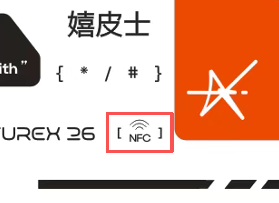

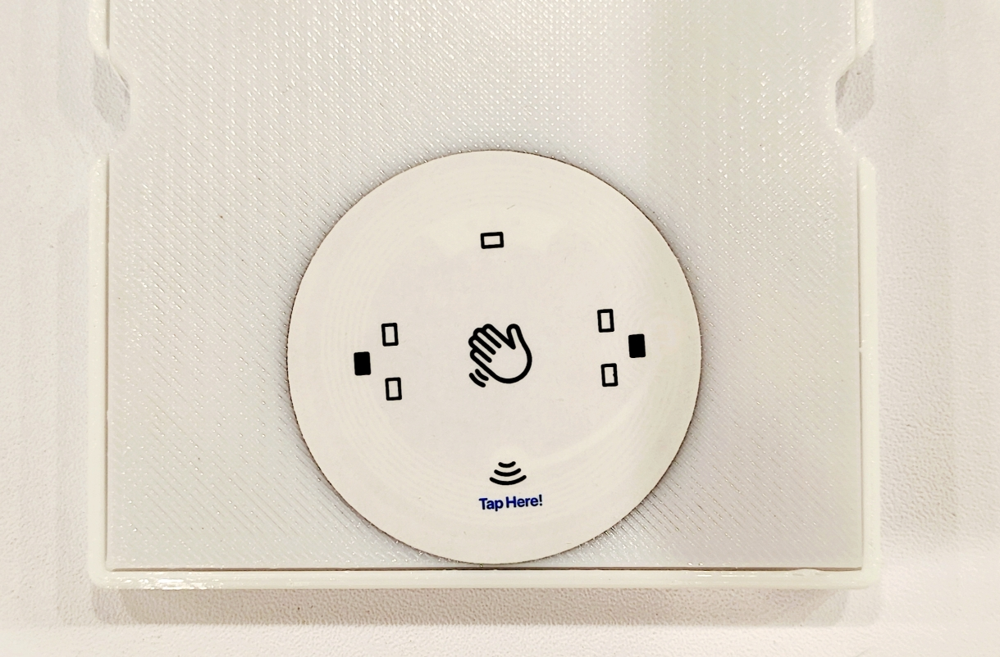

## 二、快速上手

你也可以查阅 Quote/0 文档中的 [**如何配对 Quote/0**](https://dot.mindreset.tech/docs/quote_0/start/how_to_pair) 章节完成激活

#### 环境准备

- 手机

    - iOS：需要 iOS 16 及以上版本

    - Android：需要 Android 12L 及以上版本

    - HarmonyOS：4\.0 及以下版本可直接安装；HarmonyOS NEXT 及以上版本需使用[卓易通](https://www.droitong.com/)安装

- 硬件挂牌

- 电源与 Type\-C 充电线（该物料不在选手包中提供）

#### 第一步：接入电源

将 Type\-C 电源线接入挂牌左侧面接口。配对成功前，请始终保持设备接入电源。

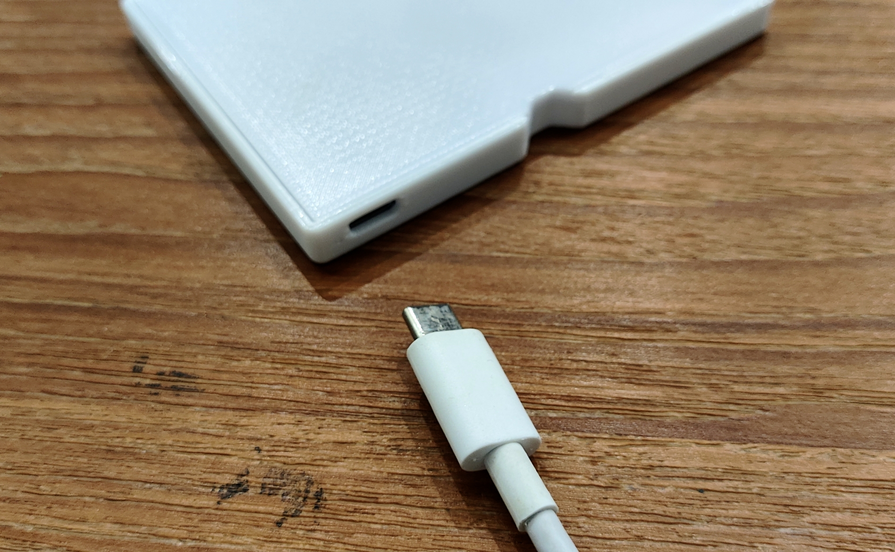

#### 第二步：安装并登录 Dot\. App

在手机上下载安装 [**Dot\. App**](https://dot.mindreset.tech/app/download)（iOS / Android 均可），注册或登录你的账号。


#### 第三步：搜索设备

打开 Dot\. App，点击主页右上角的「\+」按钮，在弹出的卡片中选择「查找设备」。稍等片刻，App 将会自动发现你的挂牌。

> 请确保手机已开启蓝牙功能并授予 App 相应的权限。
> 
> 

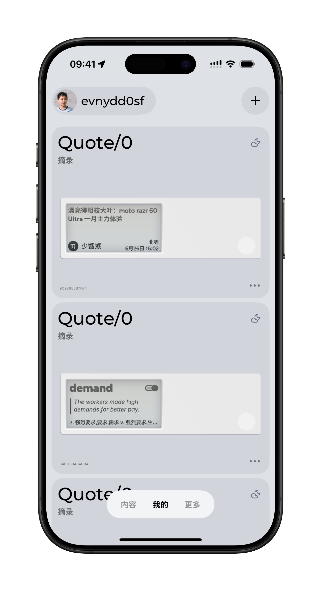

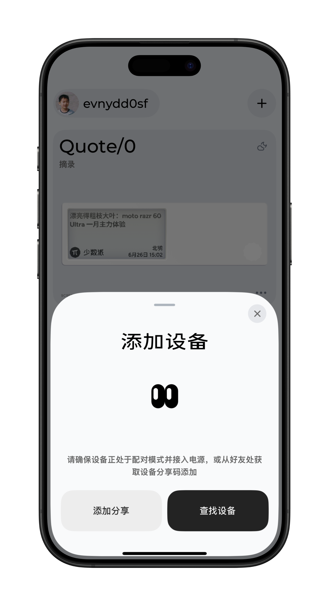


#### 第四步：连接 Wi\-Fi

选择你的 Wi\-Fi 网络（请确保网络支持 2\.4G，可连接至 AdventureX 场内网络）并输入密码，点击「传输到设备」后，挂牌将会自动开始连接网络。

- **账号：ADVX\-players**

- **密码：AdventureX**

不要连接 "hupan" 网络，该网络无 2\.4G！

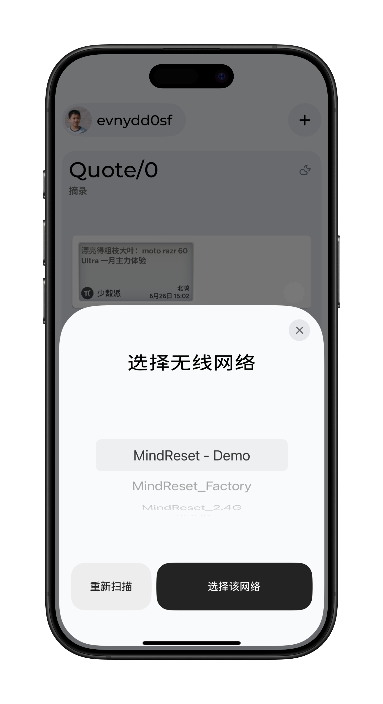

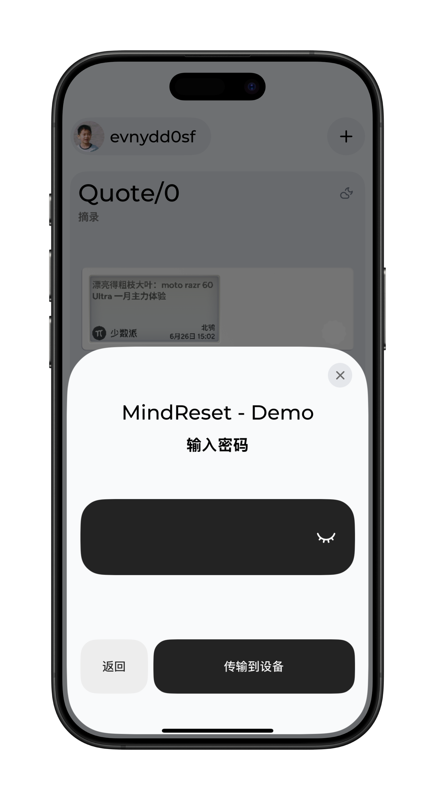

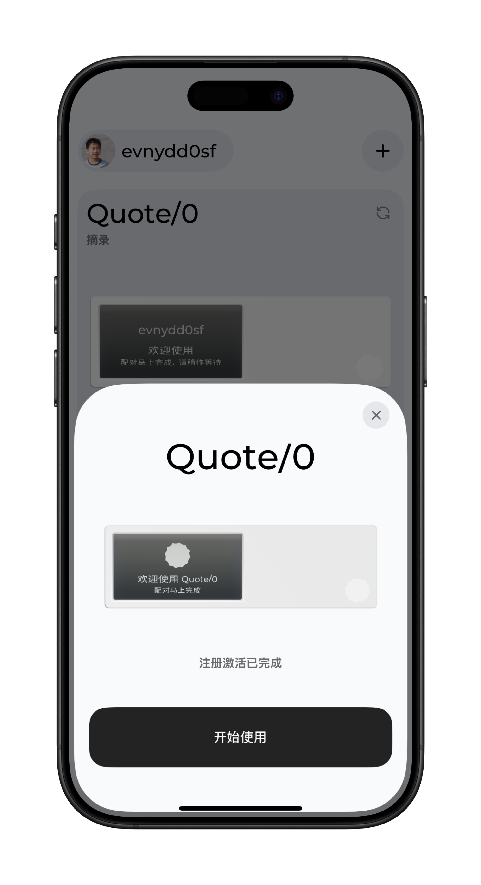

#### 第五步：完成配对

稍等片刻，您的 Quote/0 将会完成配并添加到您的设备列表中。当显示「一日一隅」时，则代表您已成功配对。

之后你就可以在 App 的“内容工坊”中选择内容模块，点击“添加到设备”推送到挂牌上。支持的内容类型包括 AdventureX 特色内容、待办、日程、天气、RSS、热榜等。

当然，想要显示什么内容完全凭你想让它显示什么\~

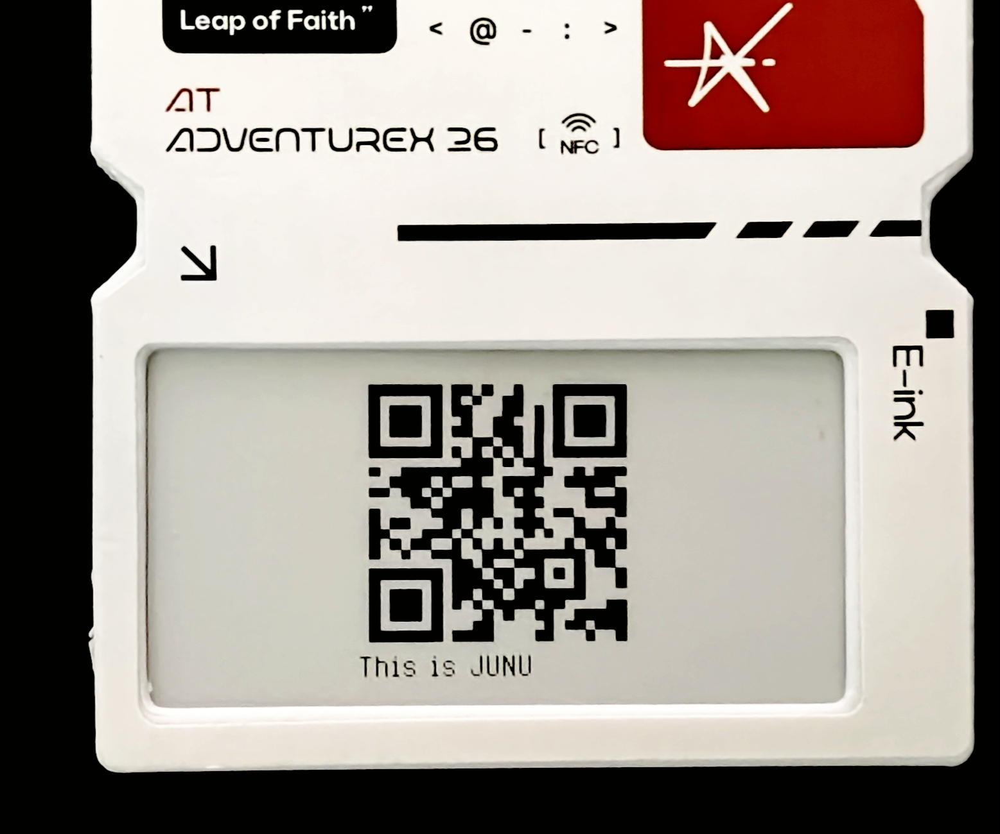

## 三、解锁 AdventureX 专属内容

我们在内容工坊中上架了 AdventureX 专属内容模块，可以在活动期间自由添加。

打开 Dot\. App 里的 “**内容工坊**”，你会看到一个 AdventureX 卡片。你可以在这里连接你的 AdventureX 账号，并显示到你的挂牌上！


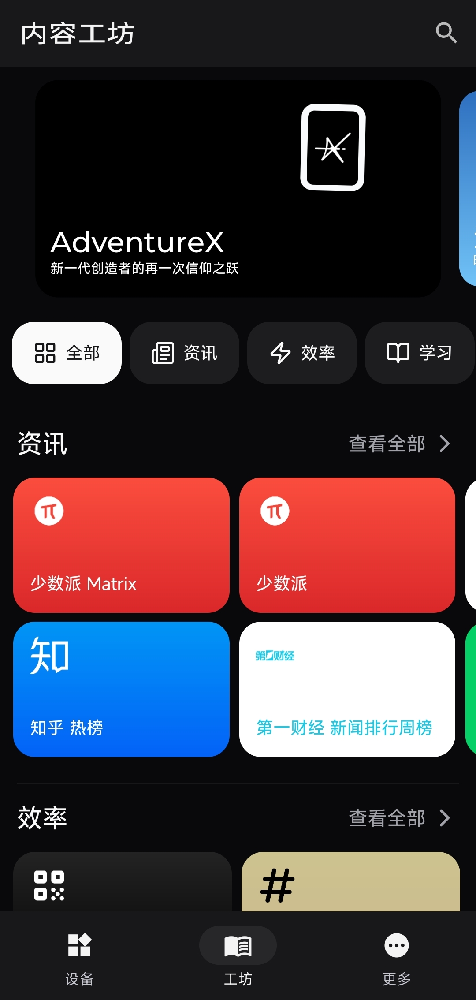

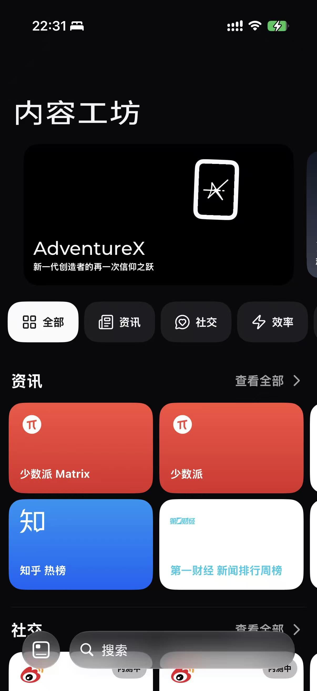


## 四、玩点花的！

如果你想了解更多功能，或者喜欢看更加专业的文档，欢迎查看 [**Dot\. 开发者平台**](https://dot.mindreset.tech/developers) ！

如果你觉得只是使用“内容工坊”的样式还不够过瘾，那你一定是一位极具创造力的极客！

**所以我们和 思维重置 一起，将硬件外壳以及固件等资料全部开放给了你！**

**整个挂牌，都由你来定义！**

这是挂牌最值得折腾的部分，我们已提供了完整的开放能力。此处只介绍三种方式简单的控制方式，更多内容可查看 [**Dot\. 开发者平台**](https://dot.mindreset.tech/developers) 。

#### 方式一：文本 / 图片 API

最直接的接入方式。通过 HTTP 请求向设备推送文字或图片，适合快速验证想法或与现有系统集成。

文字 API：

```Shell
curl --request POST \
  --url https://dot.mindreset.tech/api/authV2/open/device/{{DEVICEID}}/text \
  --header 'Authorization: Bearer {{API_KEY}}' \
  --header 'Content-Type: application/json' \
  --data '{"refreshNow":true}'
```

图像 API：

```Shell
curl --request POST \
  --url https://dot.mindreset.tech/api/authV2/open/device/{{DEVICEID}}/image \
  --header 'Authorization: Bearer {{API_KEY}}' \
  --header 'Content-Type: application/json' \
  --data '{"refreshNow":true,"image":"{{IMAGE}}"}'
```

> API 密钥在 Dot\. App 中生成和管理。
> 
> 

#### 方式二：画板 API

如果你需要自定义布局，画板 API 提供了更细粒度的控制。你可以组合文本、图片、列表、进度条等元素，构建自己的信息面板。

画板使用 JSON 描述结构和内容，支持条件渲染（`$for`、`$ifAny`）和动态数据填充。适合做仪表盘、状态监控、数据可视化等场景。

示例请求：

```Shell
curl --request POST \
  --url https://dot.mindreset.tech/api/authV2/open/device/{{DEVICEID}}/canvas \
  --header 'Authorization: Bearer {{API_KEY}}' \
  --header 'Content-Type: application/json' \
  --data '{"refreshNow":true,"data":{"badge":"DOT OPENAPI","title":"画板 API","message":"用 JSON 组合屏幕内容、状态和布局","status":"LIVE","footer":"WRITE / SEND / DONE"},"windowData":{"default":[{"type":"div","props":{"tw":"flex flex-col w-full h-full min-w-0 min-h-0 bg-white text-black gap-[8px]","children":[{"type":"div","props":{"tw":"flex flex-row items-center justify-between shrink-0 text-10-chillduansans","children":[{"type":"span","props":{"tw":"font-bold","children":"{{get inputData \"badge\" default=\"DOT OPENAPI\"}}"}},{"type":"span","props":{"children":"{{get inputData \"status\" default=\"LIVE\"}}"}}]}},{"type":"div","props":{"tw":"flex flex-col flex-1 min-h-0 justify-center gap-[6px]","children":[{"type":"div","props":{"tw":"min-w-0 text-28-chillduansans font-bold leading-none","style":{"lineClamp":2,"overflow":"hidden","textOverflow":"ellipsis"},"children":"{{get inputData \"title\" default=\"画板 API\"}}"}},{"type":"div","props":{"tw":"min-w-0 text-16-chillduansans leading-[1.16]","style":{"lineClamp":3,"overflow":"hidden","textOverflow":"ellipsis"},"children":"{{get inputData \"message\" default=\"用 JSON 组合屏幕内容、状态和布局\"}}"}}]}},{"type":"div","props":{"tw":"flex flex-row items-center gap-[6px] shrink-0 text-10-chillduansans","children":[{"type":"span","props":{"tw":"w-[6px] h-[6px] rounded-full bg-black shrink-0","children":""}},{"type":"span","props":{"tw":"min-w-0","style":{"overflow":"hidden","textOverflow":"ellipsis","whiteSpace":"nowrap"},"children":"{{get inputData \"footer\" default=\"WRITE / SEND / DONE\"}}"}}]}}]}}]},"border":0}'
```

#### 方式三：Dot Skill

如果你是一位真正的 Vibe Coder，或者只是单纯不想写代码，可以尝试用自然语言描述你想要的效果，只需要使用 Dot Skill 生成对应的画板 JSON 或直接推送内容，便可以马上看到原型！

在你的命令行运行以下指令以安装 Skill，剩下的，交给 AI 吧！

```Shell
npx skills add https://github.com/MindReset/dot_skill.git
```

## 五、注意事项

- 表面贴纸为不干胶贴纸，如果触及液体可能导致破损，请务必不要使表面触及液体。

    - 如果你希望使用 **UV 水晶贴** 以获得更加好的视觉效果，可联系@JUNU领取并自行更换！

- 该设备不防水！如果你的设备进水，请立即进行拆卸并干燥处理，避免发生电路腐蚀。

- 设备支持 NFC 碰一碰唤起轻应用。部分带磁铁或金属材质的手机壳可能干扰 NFC 信号，使用时建议取下手机壳。

- 墨水屏表面为强化塑料涂层，避免使用酒精、有机溶剂或腐蚀性清洁剂擦拭。用软布干擦即可，避免损伤屏幕。

- API 密钥在 Dot\. App 中生成，App 不会保存你的密钥，请自行备份。如怀疑泄露，可在 App 中删除并重新生成。

- 每块挂牌都由构建团队与志愿者们 ~~匠心手作~~\(手工\) 完成，若存在成品间偏差，请谅解。

如果在 AdventureX 2026 期间，你由于非人为主观因素导致 贴纸破损、电路损坏、外壳破裂、挂绳丢失 等情况，可联系 @JUNU 进行维修与更换相关组件！

## 了解更多

- FAQ / 使用手册：

[https://dot.mindreset.tech/device/quote/faq]()

- 开发者平台：

[https://dot.mindreset.tech/developers]()

- 开放 API 文档：

[https://dot.mindreset.tech/docs/service/open]()

- 社区共创：

[https://dot.mindreset.tech/docs/service/co_create]()

